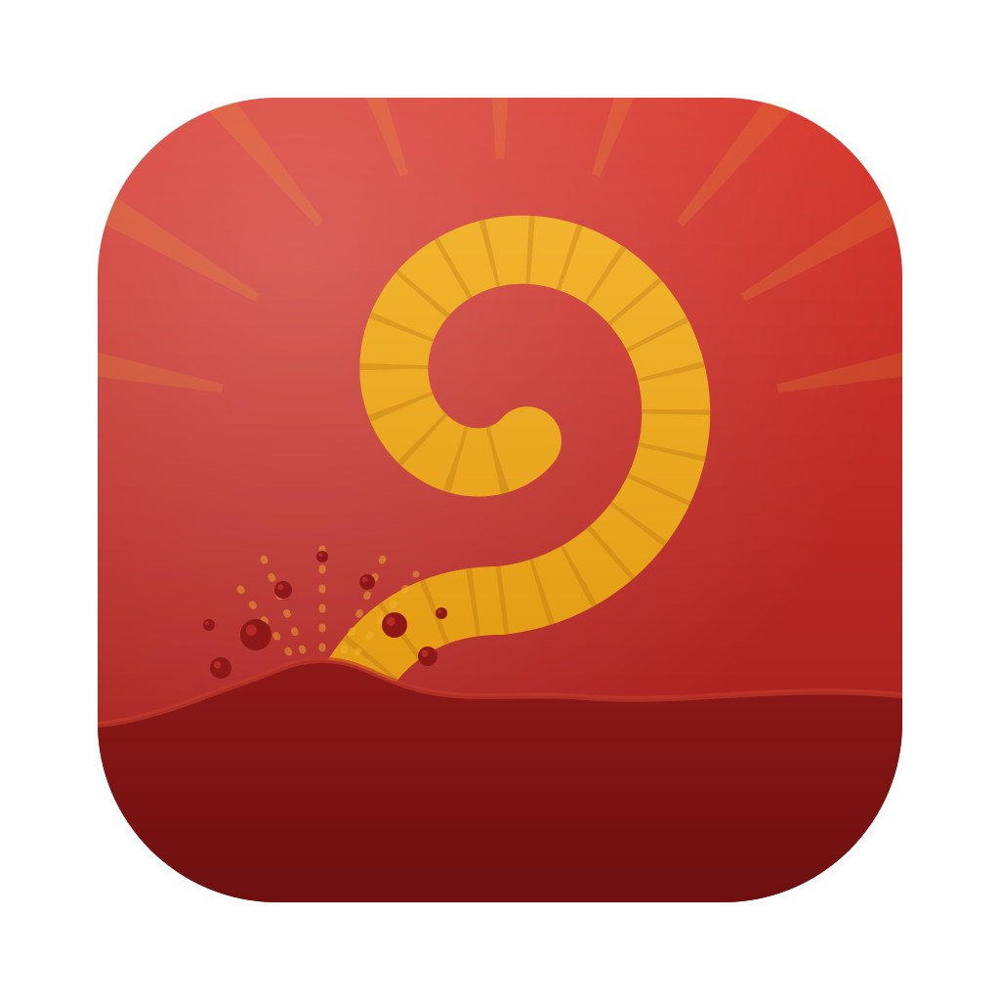

<p align="center">
  
</p>

<h1 align="center">Worm</h1>

<p align="center">Record the walkthrough. Keep the evidence. Give your agent the context.</p>

<p align="center">
  <a href="https://github.com/CantrellJax/ux-walk-cap/releases">Releases</a> ·
  <a href="UX-WALK.md">How it works</a> ·
  <a href="https://github.com/CantrellJax/ux-walk-cap/issues">Feedback</a> ·
  <a href="https://github.com/CapSoftware/Cap">Built on Cap</a>
</p>

Worm combines [Cap](https://github.com/CapSoftware/Cap)'s screen recorder and editor with [UX Walk](vendor/ux-walk)'s chapters, notes, transcripts and agent-ready evidence. It is an independent open-source fork for product walkthroughs, bug reports and design reviews.

**Worm was previously named Cap UX.** It installs over that app and keeps your recordings and settings: the bundle identifier `com.cantrell.cap-ux`, app data directory and library, Keychain items, `~/.config/ux-walk`, `~/.config/cap-ux`, the sharing server and every existing link are unchanged. Only the file name changes, so quit the app, move Worm.app to Applications and delete the old app. Sign with the same identity to keep macOS permissions. The `cap` command keeps working beside `zworm`. Run `zworm agents install` to add the `zworm` skill; a skill installed under the old name keeps working.

## What you get

- **Worm Mode in every mode picker.** Open a fresh Chrome window from the menu, recorder or mode picker, already selected for capture. Onboarding introduces it alongside Instant, Studio and Screenshot. Choose **Diatribe** inside Worm Mode to skip the browser and just talk; you get notes and action items.
- **One settings window.** Walk defaults live in General, the output folder in Recordings, and providers in Transcription. The CLI reads the same preferences.
- **Your transcription provider.** ElevenLabs Scribe, AssemblyAI, Descript, or no transcription. Existing Keychain entries are reused. Cap editor captions keep their local models.
- **Evidence an agent can read.** Video, screenshots, timestamped notes, chapters and a local report stay together. The walk's Chrome window adds semantic clicks, console warnings/errors, page exceptions and redacted failed-request diagnostics. Reports show when browser evidence is partial or unavailable.
- **Notes and handoff in your library.** Filter recordings by Worm Mode, view a walk's notes or copy its agent prompt. Assign walk shortcuts in the existing Shortcuts settings.
- **Local recording without an account.** Instant saves a ready-to-play video; Studio keeps its editable project. All recording-quality options are available.
- **Your sharing server.** Choose a compatible endpoint and expiry in Settings → Sharing. Share a video or screenshot explicitly and revoke its link from the library. Cloud sharing is off until configured.
- **Cap's editor.** Keep the original recording as evidence and edit a copy for sharing.

## Try it

Worm is currently a macOS 15+ developer preview. A signed public installer is not available yet. The native CI workflow can build an isolated **Worm Preview.app** with its own profile, the pinned UX Walk engine, a Node runtime and the native walk adapter.

Fresh walk windows use Google Chrome. The walkthrough processor currently needs FFmpeg on your Mac. Optional chapter briefs need your configured Claude CLI; agent handoffs to cmux need cmux. Cloud transcription needs your own provider key. Worm Mode does not automatically publish recordings.

For a source build, clone the repository:

```sh
git clone https://github.com/CantrellJax/ux-walk-cap.git
cd ux-walk-cap
```

Use Xcode 26 or newer with the Cap setup in [UPSTREAM-DEVELOPMENT.md](UPSTREAM-DEVELOPMENT.md) and `bun run gpui:build <target>`, install the engine dependencies with `npm ci --ignore-scripts --prefix vendor/ux-walk`, then run `node scripts/bundle-ux-walk.mjs "apps/desktop-gpui/target/<target>/release/bundle/macos/Worm.app"` after packaging with a self-contained Node 22, such as the nodejs.org build. A `--debug` build lands in `apps/desktop-gpui/target/debug/bundle/macos` instead. The bundler refuses a Homebrew Node. It signs the bundled frameworks and Node, then the app with its entitlements, and verifies the seal last, so an unsigned packaging run needs no separate `codesign` step. Rerun it after changing anything inside the app, or macOS reports the app as damaged. The engine comes from the pinned source snapshot; a separate UX Walk installation is unnecessary.

## Contribute

Try a real workflow and tell us where the recording, notes or handoff lose context. Issues and small pull requests are welcome. If this helps your team, a GitHub star helps other people find it.

## License and attribution

Worm is distributed under AGPLv3 with the MIT and third-party exceptions in [LICENSE](LICENSE). The bundled UX Walk engine is also AGPLv3. The logo is original to this fork. Cap's team built the recording and editing foundation; this fork is independently maintained and is not an official Cap release.

Upstream changes are proposed as update pull requests, reviewed and built before release. Worm has its own application identity and library, and official Cap update installers are disabled for fork builds. The desktop does not use Cap accounts, subscription plans or commercial-license activation. Existing upstream service code remains in the repository for update compatibility and is not the Worm sharing backend.

## Worm Cloud

[Worm Cloud](https://capux.jaxtrell.workers.dev) is our independent Cloudflare project, owned by Jacks Unlimited, Inc. It serves the sharing API and viewer from a Worker with private R2 storage. The desktop can use this deployment or your own compatible server; there is no mandatory cloud account.

See [cloud setup and protocol](apps/cloud/README.md) to deploy your own server. User signup, workspaces and the complete meeting-to-issues pipeline are future platform capabilities, described in [the platform design](CLOUD-PLATFORM.md). The current service uses an owner-managed upload credential and expiring unlisted links.

```sh
zworm sharing configure --server https://your-sharing-server.example --enable
zworm sharing configure --token-stdin < /path/to/protected-upload-credential
zworm upload recording.mp4 --json
zworm sharing revoke SHARE_ID
```

Credentials go in the system credential store, outside recording bundles. For headless use, set CAP_UX_UPLOAD_TOKEN. Video sharing publishes only the selected media, not raw browser traces, cookies, provider keys or walk notes.

The inherited developer instructions for the upstream web application are preserved in [UPSTREAM-DEVELOPMENT.md](UPSTREAM-DEVELOPMENT.md). Worm Cloud does not need that web application's database, billing or account services.
